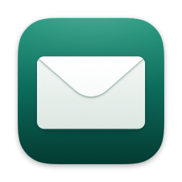
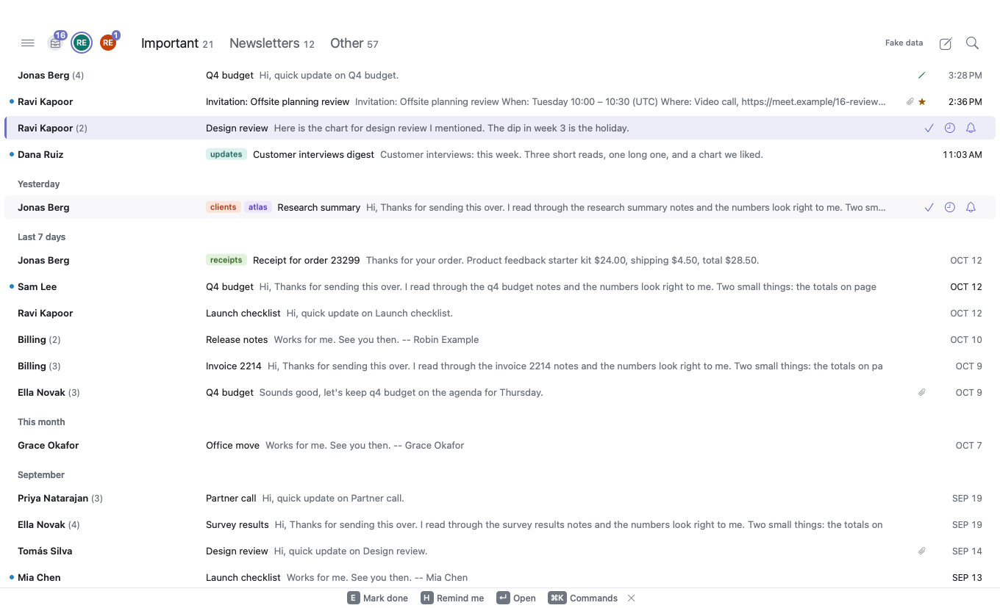
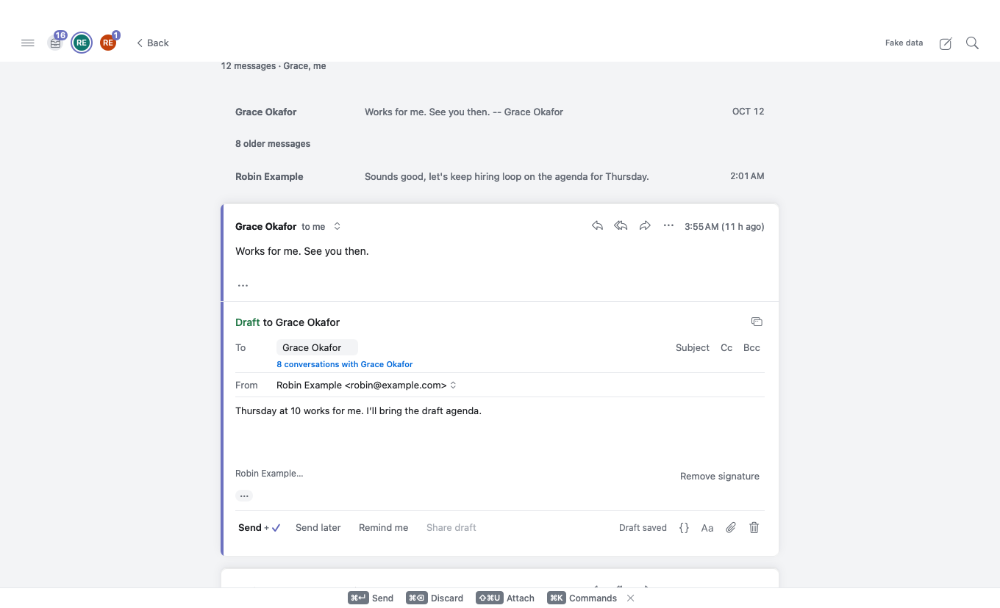
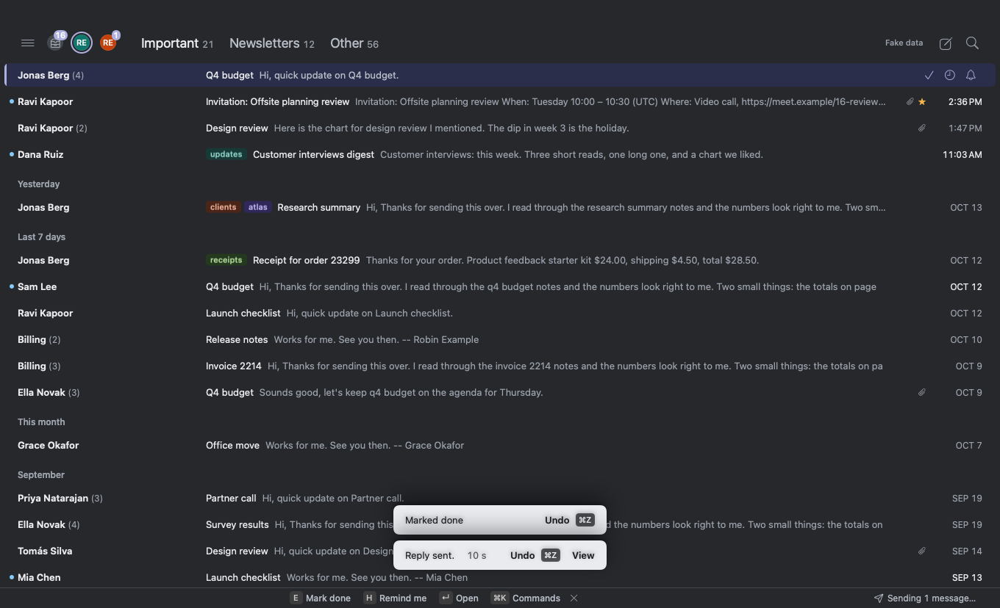
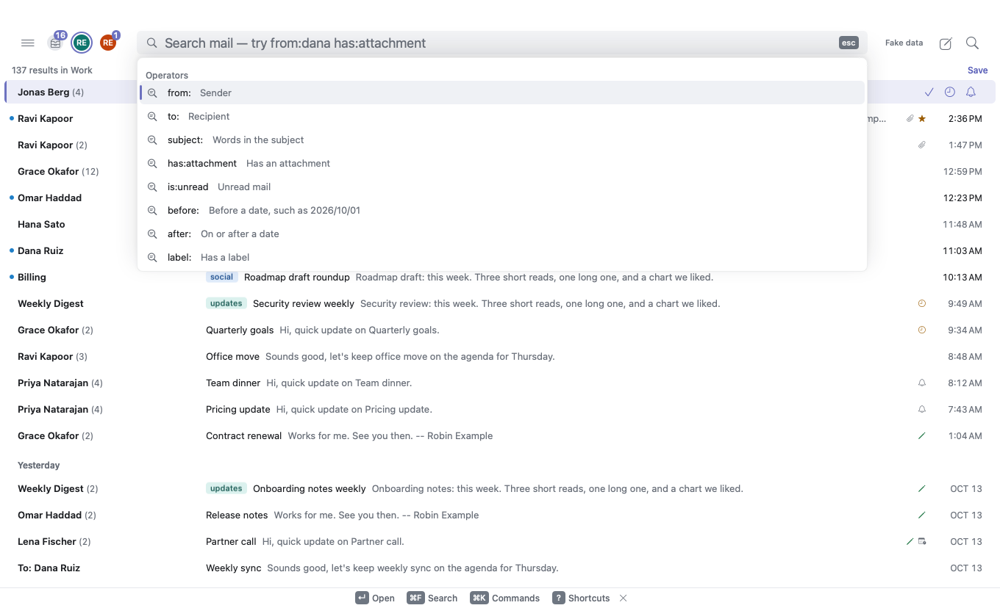
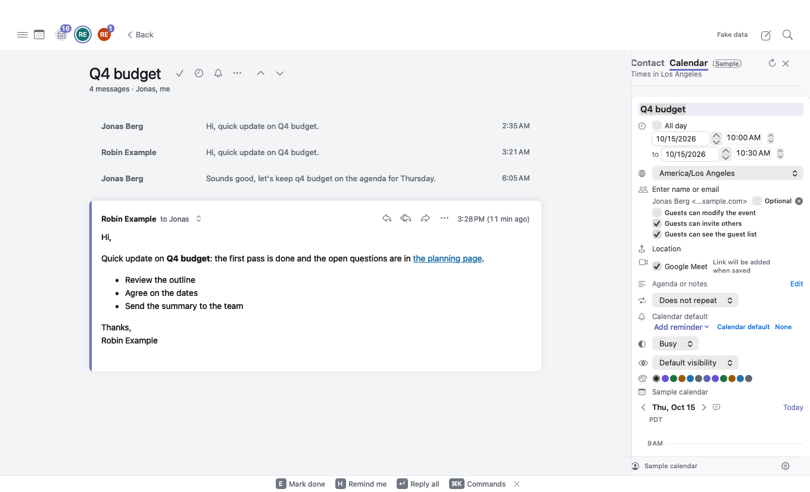

<p align="center">
  
</p>

<h1 align="center">OpenHuman</h1>

<p align="center">
  <b>Mail by OpenHuman is a keyboard-first Gmail client for macOS, with AI that runs on your Mac.</b>
</p>

<p align="center">
  
  
  <a href="LICENSE"></a>
  
</p>

<p align="center">
  <a href="#core-features">Core features</a> ·
  <a href="#opening-an-unsigned-build">Unsigned builds</a> ·
  <a href="#build">Build</a> ·
  <a href="docs/cli/README.md">CLI</a> ·
  <a href="CONTRIBUTING.md">Contributing</a>
</p>

<br>

OpenHuman is an open-source, clean-room clone of Superhuman.

It is Swift-native, runs locally (including its AI features), and is agent-ready, with a command-line interface for external AI agents.

It has only been tested on Apple silicon, macOS 27, Xcode 27, and Swift 6.4.

This is early software under active development. Unsigned builds and source builds are available now. Signed binary downloads and Homebrew installation will be announced when ready.

<br>

<p align="center">
  
  <br>
  <sub>The inbox, split into Important, Newsletters and Other. Every screenshot here shows invented sample data.</sub>
</p>

<table>
  <tr>
    <td width="50%" valign="top">
      
      <br>
      <sub>Reply inline, then send now, send later, or get a reminder.</sub>
    </td>
    <td width="50%" valign="top">
      
      <br>
      <sub>A few seconds to take back a send, in the Dark theme.</sub>
    </td>
  </tr>
  <tr>
    <td width="50%" valign="top">
      
      <br>
      <sub>Search with Gmail operators such as from: and has:attachment.</sub>
    </td>
    <td width="50%" valign="top">
      
      <br>
      <sub>Your calendar beside the conversation, with an event drafted from the email.</sub>
    </td>
  </tr>
</table>

## Core features

- **Keyboard first.** Superhuman-style shortcuts, a command palette on ⌘K, and shortcuts you can change.
- **Split inbox.** Important mail apart from the rest, plus your own splits made from any search. “Why is this here?” explains where a conversation landed.
- **Snooze, reminders and send later.** Snooze a conversation, get a reminder if nobody replies, schedule a send, and undo a send while its undo window is open.
- **Search.** Gmail search syntax, related matches from an index built on your Mac, and a Gmail lookup for mail that is not on your Mac yet.
- **AI on your Mac.** Summaries, quick replies, rewrites and Ask AI about your mail. AI runs on your Mac by default, and providers that would send mail off your Mac stay off until you allow them. Every prompt can be read and edited in Settings.
- **Calendar beside your mail.** Your Google Calendar day next to the conversation, events created from an email, and free times inserted into a reply.
- **Less noise.** Mute a conversation, block a sender or a domain, unsubscribe, and clear out old mail with Get me to zero.
- **Starts read-only.** Mail first asks Gmail for read-only access and changes nothing until you turn on write mode. It never asks to delete mail permanently or to change Gmail settings or filters.
- **Themes.** Six built-in themes, and [your own](docs/themes.md) as plain JSON files.
- **A CLI for agents.** `openhuman` reads the same local mail, writes drafts for you to review, and never sends. It includes an MCP server. See the [CLI documentation](docs/cli/README.md).

## Opening an unsigned build

macOS may block unsigned builds because they are not notarized by Apple. To open one, try to open the app once. Then open System Settings, click Privacy & Security, and scroll to Security. Click Open Anyway, enter your login password, and click OK. The Open Anyway button stays available for about an hour after you first try to open the app.

## Build

```sh
Tools/bootstrap.sh
Tools/ci/build-app.sh
open Apps/Mail/Mail.xcodeproj
```

For the CLI:

```sh
cd Packages/OpenHumanCLI
swift build -c release --product openhuman
.build/release/openhuman --help
```

See [Build and test](docs/BUILD.md), [CLI documentation](docs/cli/README.md),
and [Contributing](CONTRIBUTING.md). First-launch onboarding explains how to
create and import your own Google Desktop OAuth client. Mail and settings are stored locally on your Mac. Sign-in credentials are kept in your Keychain.

## Source layout

| Directory | Contents |
| --- | --- |
| `Apps/Mail/` | macOS application, XcodeGen project, and application tests |
| `Packages/` | Shared Swift packages, mail storage and sync, UI, AI, and CLI |
| `Tools/ci/` | Build, test, packaging, and architecture checks |
| `Tools/release/` | Versioning, Developer ID signing, notarization, and DMG tooling |
| `docs/cli/` | CLI user guide, agent guide, and JSON schema |
| `skills/openhuman-mail/` | Agent integration for the local CLI |

## License

[Apache License 2.0](LICENSE).
